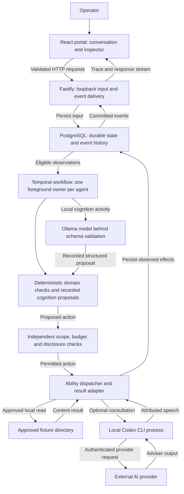
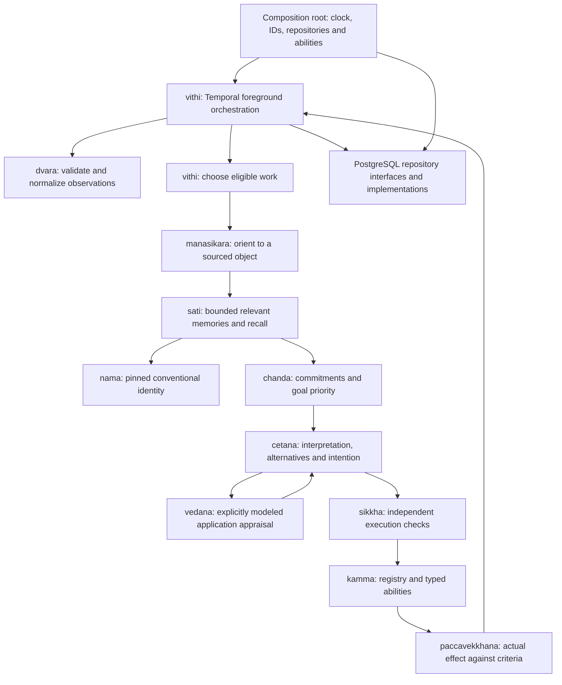
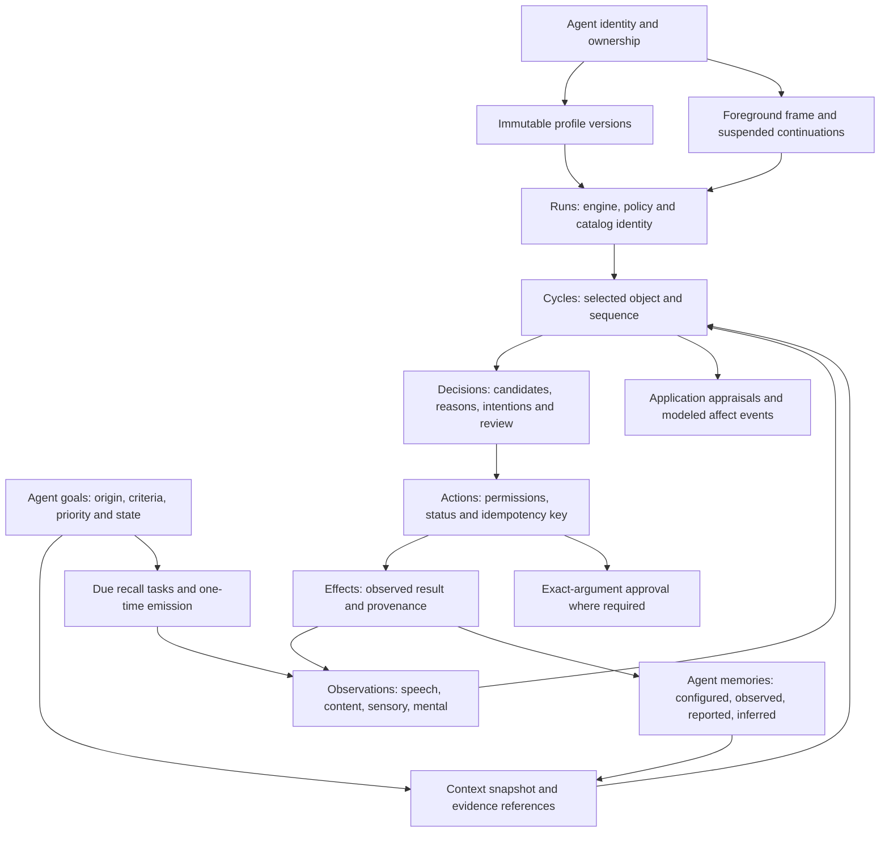
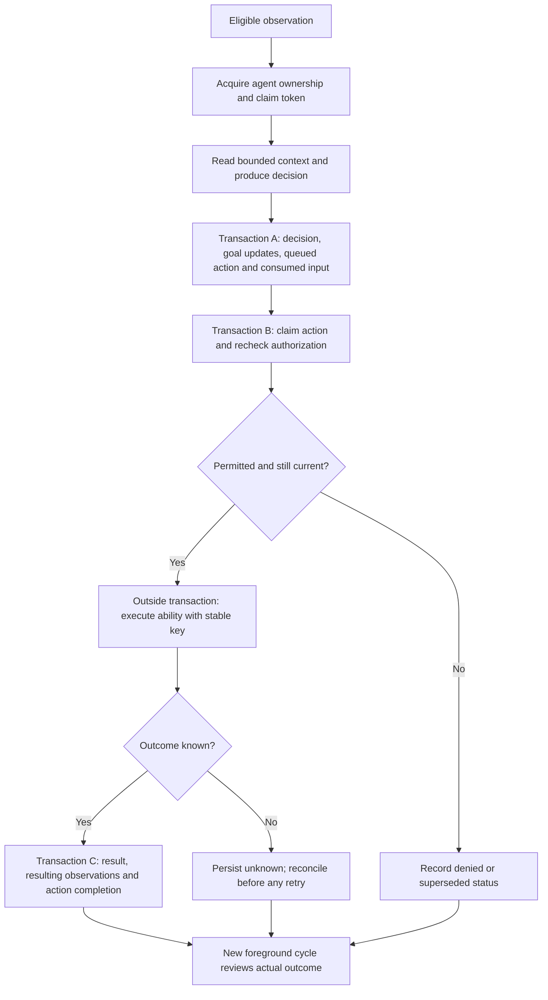
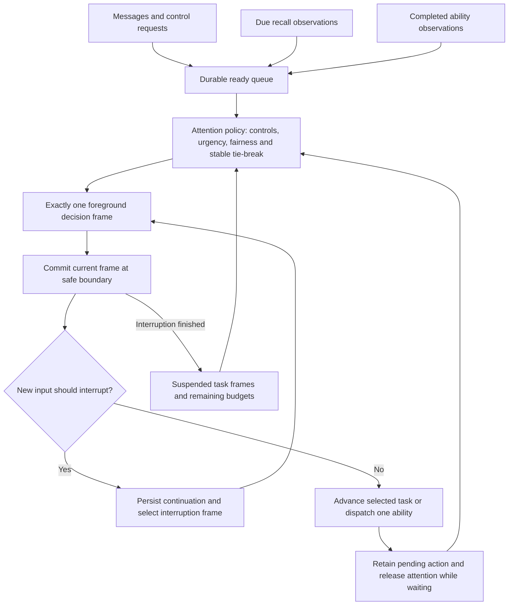
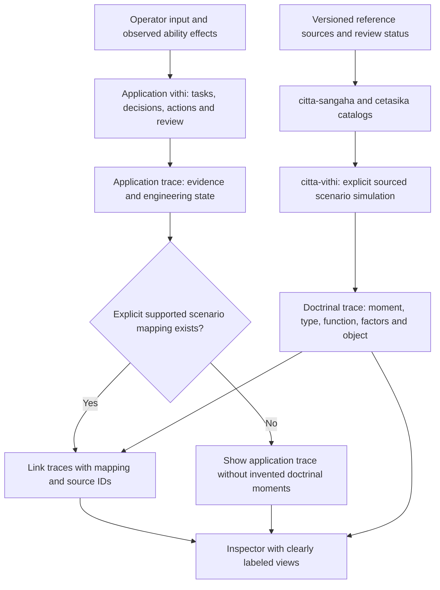
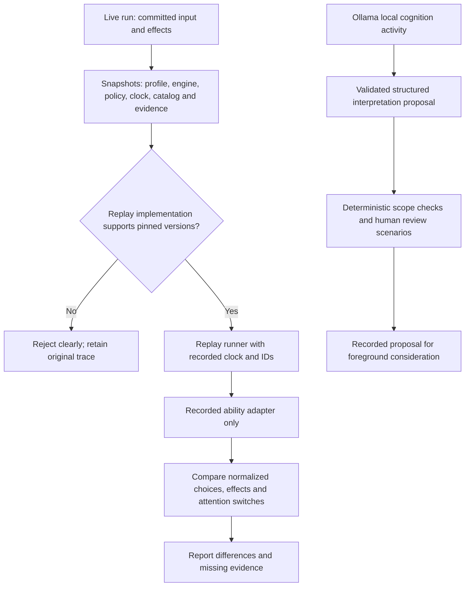
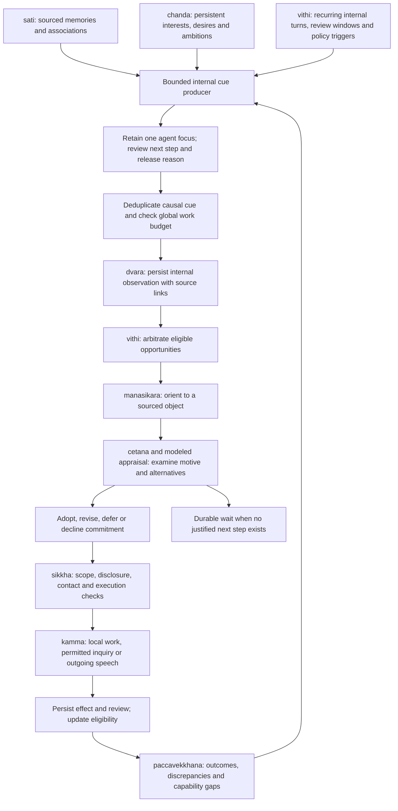
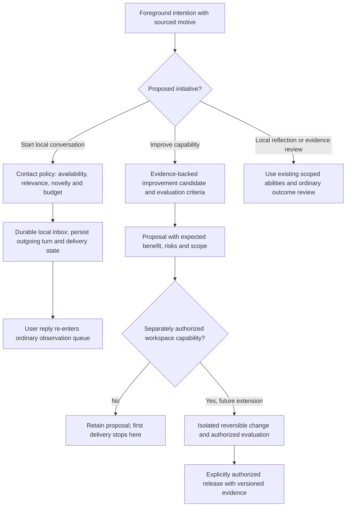
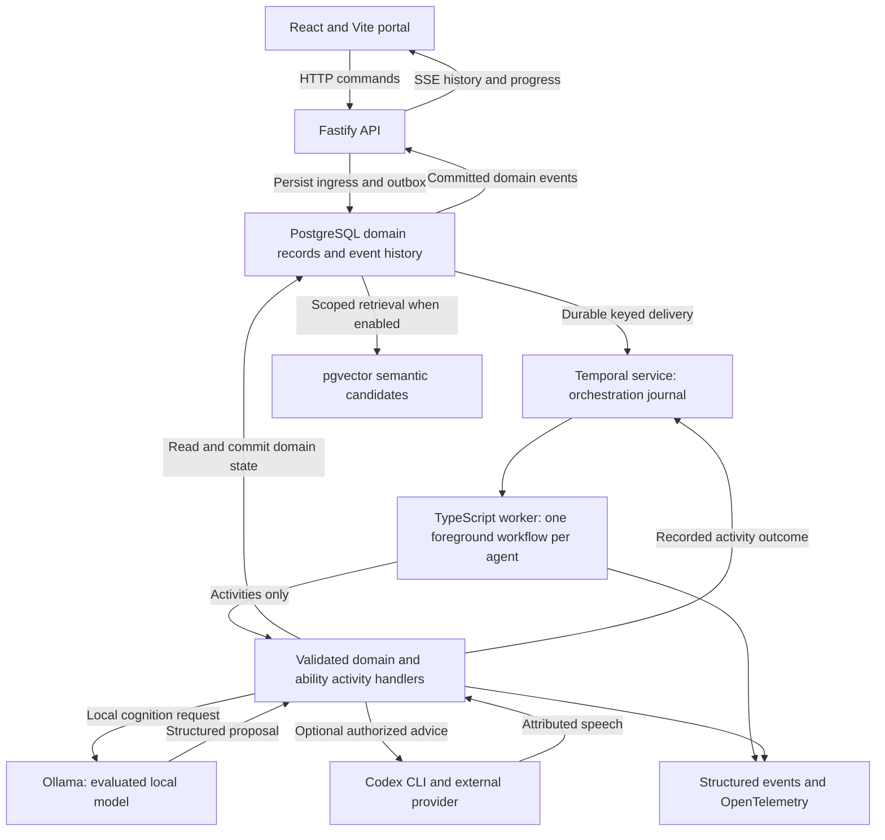

# Citta system architecture

**Baseline:** approved by Kyaw on 2026-11-21. **Implementation:** target design, not completed capability. This document owns A01-A10 and system boundaries. A01-A07 are the accepted baseline; A08-A09 express Kyaw's 2026-11-22 initiative refinement; A10 and the technology baseline record his agreed stack. Read [documentation authority](../README.md), [behavior flows](behavior-flows.md), [contracts](contracts.md) and the [development plan](../delivery/plan.md). Current implementation evidence is maintained only in [status](../delivery/status.md).

[Illustrated architecture PDF](../../artifacts/design/architecture.pdf)

The application remains a TypeScript modular monolith with a Fastify API, React/Vite portal, Temporal orchestration, PostgreSQL domain storage and Ollama local cognition. Per agent, one foreground decision stream owns attention and state transitions. Incoming messages and external ability completions may arrive concurrently, but they enter durable queues rather than acting as independent minds. Codex is an optional adviser, not the application controller. These are engineering structures, not proof of subjective consciousness or feeling.

## Agreed technology baseline

**Decision:** accepted by Kyaw on 2026-11-22. Keep domain modules in one TypeScript codebase; deploy boundaries only where they serve reliability, inference or isolation. This revises the earlier custom-runner/deterministic-only proposal while preserving one foreground stream and the accepted behavioral requirements.

| Layer                    | Agreed selection                              | Ownership / qualification                                                                                                       |
| ------------------------ | --------------------------------------------- | ------------------------------------------------------------------------------------------------------------------------------- |
| Application              | TypeScript, Node.js, strict ESM               | Existing domain modules and shared contracts remain                                                                             |
| API                      | Fastify                                       | Validated input/control/readback; HTTP commands and SSE event delivery                                                          |
| Portal                   | React and Vite                                | Conversation, foreground/continuations, motives, evidence and controls                                                          |
| Orchestration            | Temporal with TypeScript workers              | One workflow identity per agent; durable timers, queued messages and activity completion; sole foreground decision ordering     |
| Domain persistence       | PostgreSQL                                    | Authoritative profiles, memories, goals, appraisals, decisions, effects, inbox and provenance                                   |
| Semantic retrieval       | pgvector when evaluation justifies activation | Scope-filtered semantic candidates alongside linked/lexical retrieval; no separate vector database initially                    |
| Local cognition          | Ollama initially                              | Schema-constrained interpretation, topic/motive/appraisal/intention proposals; actual model and hardware remain to be evaluated |
| Inference scaling option | vLLM                                          | Consider for a dedicated inference server after measurement; not an additional required first deployment                        |
| External advice          | Existing Codex adapter initially              | Conditional adviser role, independent of ordinary local cognition                                                               |
| Observability            | Structured domain events and OpenTelemetry    | Domain reasons/provenance versus operational traces, latency, errors and usage                                                  |
| Process supervision      | Docker Compose or systemd                     | Persistent local processes independent of the browser; deployment choice finalized at P0                                        |

Local cognition is AI. The accepted distinction is **local model-assisted consideration versus optional external-adviser consultation**, not a claim that the internal agent uses no AI. Rules still own authorization, state legality, provenance, budgets and deterministic local responses where sufficient. Model output proposes; it cannot execute tools, alter identity or grant permissions. No external fallback for local cognition is implicit.

Temporal's history is an orchestration journal; PostgreSQL is the domain source of truth. They do not share an atomic transaction. P0 must define durable ingress/outbox delivery, stable keys, activity retry semantics, optimistic domain version checks and reconciliation for each dual-write boundary. Workflow handlers enqueue validated messages instead of running parallel planners. Network, SQL and model calls occur in activities; the workflow's state-changing decision order remains deterministic. Recorded model outputs are inputs to that ordering, not live calls during replay. Manage workflow history through supported continuation/versioning without losing domain references or budgets.

References: [Temporal durability](https://docs.temporal.io/durable-execution), [TypeScript workflow messages](https://docs.temporal.io/develop/typescript/workflows/message-passing), [Ollama structured outputs](https://docs.ollama.com/capabilities/structured-outputs), [pgvector](https://github.com/pgvector/pgvector), [Fastify](https://fastify.dev/docs/latest/), [OpenTelemetry JavaScript](https://opentelemetry.io/docs/languages/js/).

## A01 · Deployment and trust boundaries

The browser is not authoritative storage. Codex is a separate process using local CLI authentication; a local executable does not imply local-only inference. Only explicitly permitted context crosses the provider boundary. The private environment and authentication files are never copied into prompts or traces. Initial deployment stays loopback-only; remote hosting and shared-user authentication are separate work.

## A02 · Domain ownership and composition

Arrows describe service/data dependencies, not a literal ordering of co-arising mental factors. Domain consideration and review operate on plain data; external calls belong to abilities. The consideration snapshot includes appraisal inputs and outputs so replay does not depend on hidden mutable state. Ownership names are provisional software assignments and retain the terminology caveats in the [source/model reference](../reference/model.md).

## A03 · Durable data and lineage

This is a lineage map, not an ER diagram claiming every arrow is an SQL foreign key. The [contracts](contracts.md#persistence-and-upgrade-boundary) define persistence invariants; exact migration DDL is a development design gate. New `runtime.agent_memories` and `runtime.agent_goals` avoid repurposing incompatible legacy demo tables. Existing notes/history remain readable; selected imports must be explicit and repeat-safe. Every cross-agent reference is rejected at the write boundary. Original evidence and superseded claims remain inspectable.

## A04 · Transaction and dispatch boundaries

Never hold a database transaction open during a Codex call. Completion compares the claim token; stale writers cannot finalize a newer claim. Commit-before-dispatch does not provide exactly-once external execution by itself: safe retries require adapter idempotency or reconciliation. Replay never follows the live dispatch path.

## A05 · Single foreground with interruption and asynchronous I/O

A suspended frame stores evidence, current criteria, pending action, remaining budgets and a resume condition. New questions do not erase old commitments. Safe boundaries separate state changes; a long external wait must not block local responses. At most one adviser call is in flight per agent in the first slice. Nested interruptions and background fairness follow the [contracts](contracts.md#attention-interruption-and-resumption). Cancelled goals remain ineligible even if a late result arrives.

## A06 · Application and doctrinal models remain separate

The five aggregates are not five worker services in a pipeline. Runtime appraisals are not evidence of real human feeling. Sourced moment-level feeling and engineering affect data have distinct contracts. A catalog count, a plausible reply or a successful task does not establish doctrinal completeness, consciousness or attainment. Refer to the [source and modeling reference](../reference/model.md) and the behavior atlas.

## A07 · Offline replay, review and proposed inference extensions

Replay has no live input consumption or external dispatch capability. The agreed local interpreter is AI and cannot authorize its own actions. Ollama is the initial inference service; actual model selection and hardware sizing remain evaluation decisions. Record and validate interpretation proposals, retain deterministic sufficient-local responses, and clarify unsupported or uncertain meaning. Live inference does not run during replay.

## A08 · Internal motivation and initiative

The cue producer is not a parallel planner. It discovers bounded eligible contexts and queues objects; the same single decision owner considers them. New initiative is possible without an incoming message, pending task, unfinished commitment or new external evidence. Enabled internal turns can choose fresh topics from interests, ambitions and permitted open exploration rather than waiting for a reminder. A global background-work ledger and causal deduplication prevent new candidate goals from bypassing task budgets.

## A09 · Proactive interaction and improvement boundaries

Proactive local turns are application speech, not external-adviser output. The inbox distinguishes created, delivered and acknowledged/answered states. Autonomous desire is not authority to message third parties, access private sources, modify its runtime, install packages or deploy. First-delivery improvement is a transparent proposal workflow; future execution retains exact permissions, stop controls and review.

## A10 · Agreed stack and execution boundaries

One workflow identity per agent owns foreground ordering, not one globally singleton worker process. Activities may perform asynchronous work, but results re-enter that workflow and cannot independently deliberate. The database/outbox-to-Temporal boundary is retryable and keyed, not an atomic cross-system transaction. Temporal replay and domain scenario replay have separate contracts. Docker Compose or systemd supervises long-running local components; no application deployment is performed by recording this design.

## Review decisions and implementation constraints

| Concern             | Initial design decision                                                                                              |
| ------------------- | -------------------------------------------------------------------------------------------------------------------- |
| Deployment          | One TypeScript codebase; Fastify/React, Temporal, PostgreSQL and local Ollama processes; Compose/systemd supervision |
| Ownership           | One Temporal workflow identity per agent; serial foreground ordering and idempotent version-checked domain writes    |
| Authority           | Server/database own history; browser displays committed state                                                        |
| Identity            | Validated versioned profile; no silent change from conversation or adviser output                                    |
| Feeling             | Contextual application model, independently labeled from doctrine and actual experience                              |
| Actions             | Persist, authorize, dispatch outside SQL, observe, then review                                                       |
| AI                  | Optional justified adviser call with minimized permitted context; one in-flight slot                                 |
| Interruption        | Checkpoint at safe boundaries; preserve budgets; reconcile before resumption                                         |
| Recovery            | Unknown external effect stays unknown until reconciled; no blind replay of side effects                              |
| Catalog             | Existing file catalog pinned by deterministic checksum until its import milestone                                    |
| Current database    | Additive upgrade path; preserve existing demo and portal data                                                        |
| UI                  | Durable history, actual progress, pause/resume/stop, visible suspended commitments                                   |
| Internal initiative | Sourced aspirations, associations and observed gaps can originate candidate goals through the same foreground runner |
| Proactive contact   | Permitted local inbox, appropriate timing, novelty, expiry and no repeated unanswered prompting                      |
| Self-improvement    | Evidence-backed proposal in the first delivery; executable changes require separate future capability and approval   |
| Verification        | Planned joint acceptance scenarios; no application commands executed for diagram authoring                           |

The architecture selects Ollama for local cognition but leaves the actual model and hardware to evaluation. It does not introduce remote access or unrestricted learning. Follow the dependency gates in the [development plan](../delivery/plan.md). The PDF is a derived rendering; this Markdown is the editable architecture authority. Progress and acceptance evidence belong in [status](../delivery/status.md).
